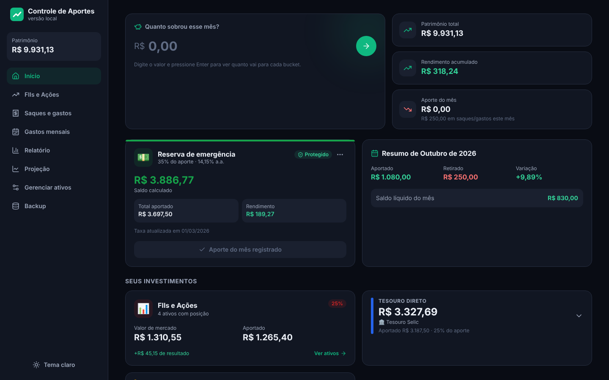
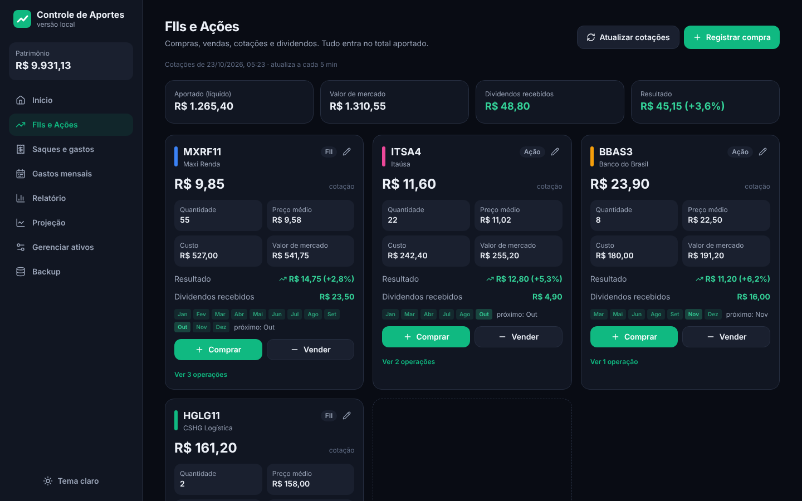
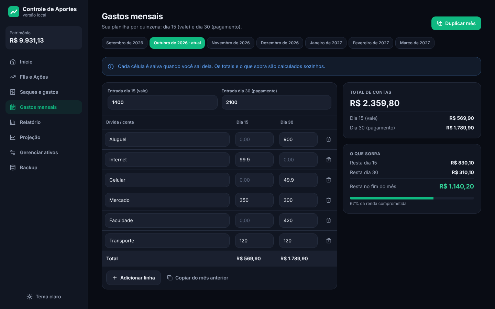
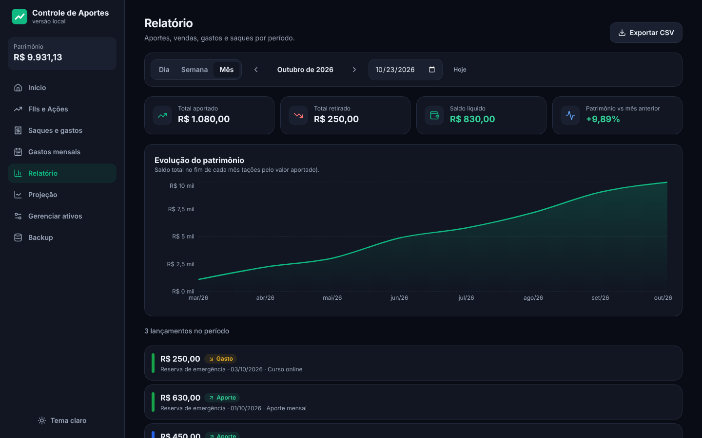
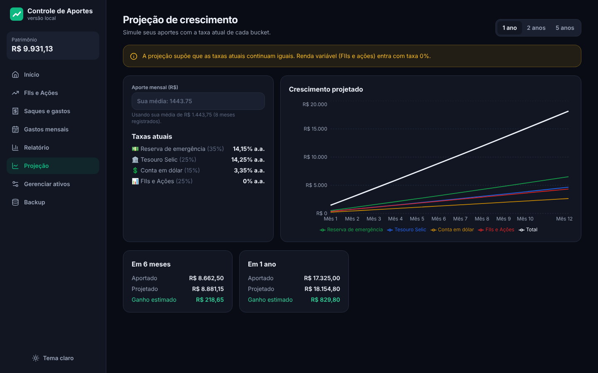
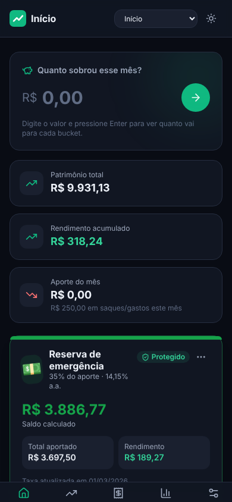

# Controle de Aportes

[](https://github.com/abnersf23-cmd/controle-de-aportes/actions/workflows/testes.yml)

Aplicativo web para organizar **aportes mensais, investimentos e gastos pessoais**, funcionando
**100% no navegador e offline**: os dados ficam no próprio computador (IndexedDB), sem login e
sem servidor na nuvem.

Nasceu como um protótipo no Base44 (plataforma no-code) e foi **reescrito do zero em React** para
ter controle total do código, dos dados e dos cálculos.



> Todos os valores das imagens são **fictícios**, gerados só para demonstração
> (arquivo [`exemplo/carteira-ficticia.json`](exemplo/carteira-ficticia.json)).

## O problema

Todo mês sobra um valor do salário e ele precisa ser dividido entre reserva de emergência,
Tesouro, dólar e renda variável, cada um com uma porcentagem. Fazer isso em planilha dava trabalho
e não mostrava quanto cada parte realmente rendeu. O app responde a três perguntas:

1. **Quanto sobrou este mês e para onde vai cada real?**
2. **Quanto eu tenho hoje, considerando os juros de cada investimento?**
3. **Quando chego na minha meta?**

## Funcionalidades

| Aba | O que faz |
|---|---|
| **Início** | Divide o valor que sobrou entre os "buckets" pela porcentagem de cada um, assistente que sugere quanto aportar da sobra do mês, meta da reserva de emergência, **previsto x realizado** dos aportes, **saldo projetado até o fim do mês**, aviso de **orçamento estourado**, aviso de **Selic/CDI novos do Banco Central**, patrimônio total, rendimento, meta e gráficos |
| **FIIs e Ações** | Compra e venda, preço médio, cotação automática (Yahoo Finance), dividendos recebidos e calendário de dividendos |
| **Saques e gastos** | Histórico com filtro, gráfico por categoria e exportação CSV |
| **Gastos mensais** | Planilha por quinzena (dia 15 e dia 30) com "duplicar mês" para até 12 meses contas fixas (📌) que se repetem sozinhas, parcelas com fim, categorias com gráfico, **orçamento por categoria** (aviso a 80% e ao passar do limite), **simulador "antecipar parcelas x investir"** e marcação de contas pagas |
| **Relatório** | Lançamentos por dia, semana ou mês, evolução do patrimônio e CSV |
| **Projeção** | Simulação de 1 a 10 anos a partir do patrimônio atual, **descontando a inflação** (IPCA do Banco Central) e **metas de R$ 10 mil, 100 mil, 500 mil e 1 milhão** |
| **Gerenciar ativos** | Buckets, taxas (CDI, Selic, Fed, personalizada), bucket protegido e rebalanceamento automático para 100% |
| **Backup** | Exportar/restaurar `.json` (dados **e configurações**), **backup com senha** (AES-256) e backup automático diário numa pasta escolhida |

Também tem tema claro/escuro, layout responsivo (menu lateral no computador, barra inferior no
celular), confirmação antes de excluir e botão "Desfazer".

<table>
  <tr>
    <td></td>
    <td></td>
  </tr>
  <tr>
    <td></td>
    <td></td>
  </tr>
</table>

<p align="center"></p>

## Tecnologias

| Camada | Escolha | Por quê |
|---|---|---|
| Interface | **React 18** + **Vite** | Componentes reaproveitáveis e servidor de desenvolvimento rápido |
| Estilo | **Tailwind CSS** | Tema claro/escuro com variáveis CSS (*design tokens*) |
| Dados | **IndexedDB** via **Dexie** | Banco que já vem no navegador: funciona offline e os dados não saem do computador |
| Reatividade | `dexie-react-hooks` (`useLiveQuery`) | A tela atualiza sozinha quando o banco muda |
| Gráficos | **Recharts** | Gráficos de pizza, linha e área |
| Ícones | **lucide-react** | |
| Testes | **Vitest** + `fake-indexeddb` | Testa cálculos e banco sem abrir navegador |
| Testes de interface | **Playwright** | Abre o app no Chromium e testa os fluxos como um usuário |

## Como rodar

Pré-requisito: [Node.js](https://nodejs.org) 18 ou mais novo.

```bash
git clone https://github.com/abnersf23-cmd/controle-de-aportes.git
cd controle-de-aportes
npm install
npm run dev        # abre http://127.0.0.1:5173
```

No Windows também dá para dar dois cliques em `abrir-app.bat`.

**Quer ver o app com dados?** Na tela de boas-vindas, clique em *Importar meus dados* e escolha
[`exemplo/carteira-ficticia.json`](exemplo/carteira-ficticia.json). Ou clique em *Começar do zero*.

Outros comandos:

```bash
npm test           # testes automáticos
npm run test:e2e   # testes de interface (Playwright)
npm run build      # versão de produção em dist/
```

## Decisões técnicas

**Dados só no navegador (local-first).** Como são dados financeiros pessoais, a decisão foi não ter
servidor: não há senha para vazar nem banco na nuvem para proteger. O custo é que limpar os dados
do navegador apaga tudo, por isso existe a aba Backup, com backup automático via
[File System Access API](https://developer.mozilla.org/docs/Web/API/File_System_API) (Chrome/Edge)
e lembrete após 7 dias sem backup nos outros navegadores.

**Cálculos em funções puras.** Toda a matemática está em [`src/lib/finance.js`](src/lib/finance.js),
sem React e sem banco: recebe dados, devolve números. Isso permite testar cada fórmula isoladamente.
Os principais cálculos:

- **Juros compostos diários** com histórico de taxas: quando a taxa muda, o passado continua com a
  taxa antiga. Fórmula: `saldo × (1 + taxa/100/365)^dias`.
- **Bucket em dólar:** cada aporte é convertido pela cotação do dia, rende em US$, e o app separa o
  rendimento do ativo da variação cambial.
- **Preço médio** de ações e FIIs considerando compras e vendas.
- **Rebalanceamento:** ao criar ou excluir um bucket, as porcentagens dos outros são ajustadas para
  a soma continuar 100%, sem mexer no bucket "protegido".

**Datas no fuso local.** O protótipo original usava `toISOString()` (UTC). No Brasil (UTC−3), depois
das 21h o app achava que já era o dia seguinte e, no último dia do mês, registrava o aporte no mês
errado. A versão nova trata datas como texto `AAAA-MM-DD` no fuso local, com testes específicos em
[`src/lib/dates.test.js`](src/lib/dates.test.js).

**Proxy para cotações.** O navegador bloqueia chamadas diretas ao Yahoo Finance (regra de
[CORS](https://developer.mozilla.org/docs/Web/HTTP/CORS)). O servidor do Vite faz a chamada no lugar
do navegador ([`vite.config.js`](vite.config.js)). Só o **ticker** (ex.: `MXRF11`) sai do computador,
nunca valores. Sem internet, o app usa as últimas cotações salvas.

**Taxas do Banco Central.** Selic (série 432), CDI (4389) e IPCA 12 meses (13522) vêm da
[API SGS](https://dadosabertos.bcb.gov.br/) do Banco Central, também pelo proxy do Vite, no máximo
uma vez a cada 12 horas. O app **não muda a taxa sozinho**: ele avisa e você confirma com um clique,
e a taxa nova entra no histórico a partir de hoje.

**Inflação na projeção.** O valor "de hoje" usa a taxa real pela equação de Fisher:
`(1 + juros) / (1 + inflação) − 1`. Com 14% de juros e 4,5% de inflação, o ganho real é 9,09%, não 9,5%.

**Backup com senha.** Usa a [Web Crypto API](https://developer.mozilla.org/docs/Web/API/Web_Crypto_API)
do navegador, sem biblioteca: PBKDF2 (SHA-256, 310 mil iterações, sal aleatório) gera a chave e
AES-GCM de 256 bits criptografa. O GCM detecta arquivo alterado ou senha errada. A senha não é
guardada em lugar nenhum ([`src/lib/crypto.js`](src/lib/crypto.js)).

**Transações no banco.** Importar backup e duplicar meses usam `db.transaction`: ou tudo é gravado,
ou nada. Um erro no meio não deixa dados pela metade.

**Segurança.** O servidor local escuta só em `127.0.0.1` (não fica acessível pela rede) e o
`.gitignore` bloqueia arquivos de dados (`dados-*.json`, `backup-*.json`) para que nunca entrem no
repositório.

## Testes

```bash
npm test
npm run test:e2e   # testes de interface (Playwright); na 1ª vez: npx playwright install chromium
```

Os testes também rodam sozinhos no GitHub Actions a cada push
([`.github/workflows/testes.yml`](.github/workflows/testes.yml)): os de lógica duas vezes (fuso UTC e
fuso de Brasília, para pegar erros de data que só aparecem em um deles) e os de interface no Chromium.

**73 testes de lógica** (Vitest) cobrindo:

- juros compostos diários e troca de taxa no meio do período;
- conversão e rendimento em dólar;
- rebalanceamento das porcentagens;
- preço médio, quantidade e dividendos;
- tempo estimado para atingir a meta;
- datas no fuso local (incluindo o horário depois das 21h);
- importação/exportação de backup (incluindo o formato antigo do Base44);
- duplicação da planilha de gastos;
- previsto x realizado, saldo projetado do mês e orçamento por categoria;
- leitura da API do Banco Central e taxa real (inflação);
- backup com senha (senha errada, arquivo alterado, senha curta);
- simulador de antecipar parcelas x investir (valor presente e IR regressivo);
- nomes com acento ou maiúscula diferente ("MÃE" e "Mae" são a mesma conta).

**6 testes de interface** (Playwright, em [`e2e/`](e2e)) que abrem o app e clicam como um usuário:
plano de aportes, aviso de Selic nova, orçamento estourado, simulador de parcelas, projeção com metas e backup com senha.
As respostas do Banco Central e do Yahoo são simuladas, então os testes não dependem da internet.

## Estrutura do código

```
src/
  lib/          finance.js (cálculos), dates.js, csv.js + testes
  db/           database.js (tabelas Dexie), backup.js, expenses.js + testes
  hooks/        useFinanceData, useExpenses, useAutoBackup (ligam banco e tela)
  services/     quotes.js (Yahoo / dólar), autoBackup.js
  pages/        uma tela por aba
  components/   cards, formulários, gráficos e peças de interface
exemplo/        carteira fictícia para testar o app
docs/           imagens deste README
```

## Próximos passos

- [ ] Versão desktop instalável (Tauri ou Electron)
- [x] Testes de interface (Playwright)
- [ ] Importar extrato da corretora (CSV)
- [x] Integração contínua com GitHub Actions rodando os testes a cada push

---

Feito por **Abner** como projeto de estudo em Análise e Desenvolvimento de Sistemas.
